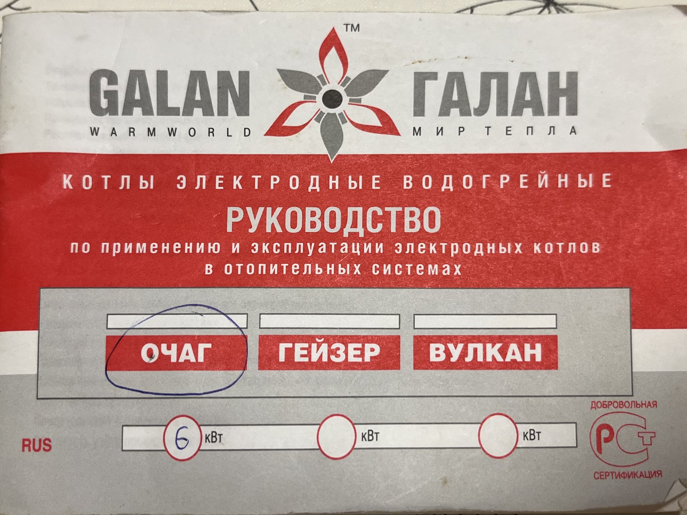
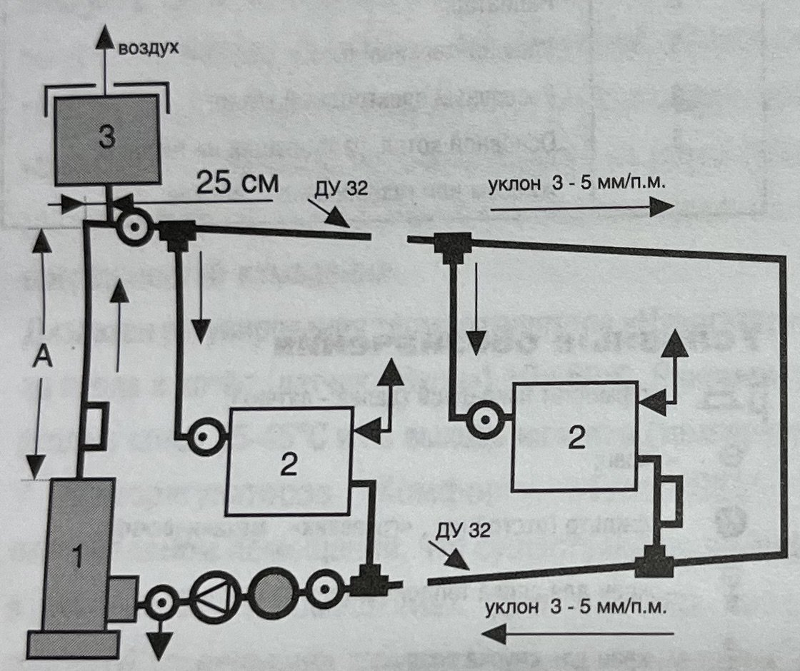
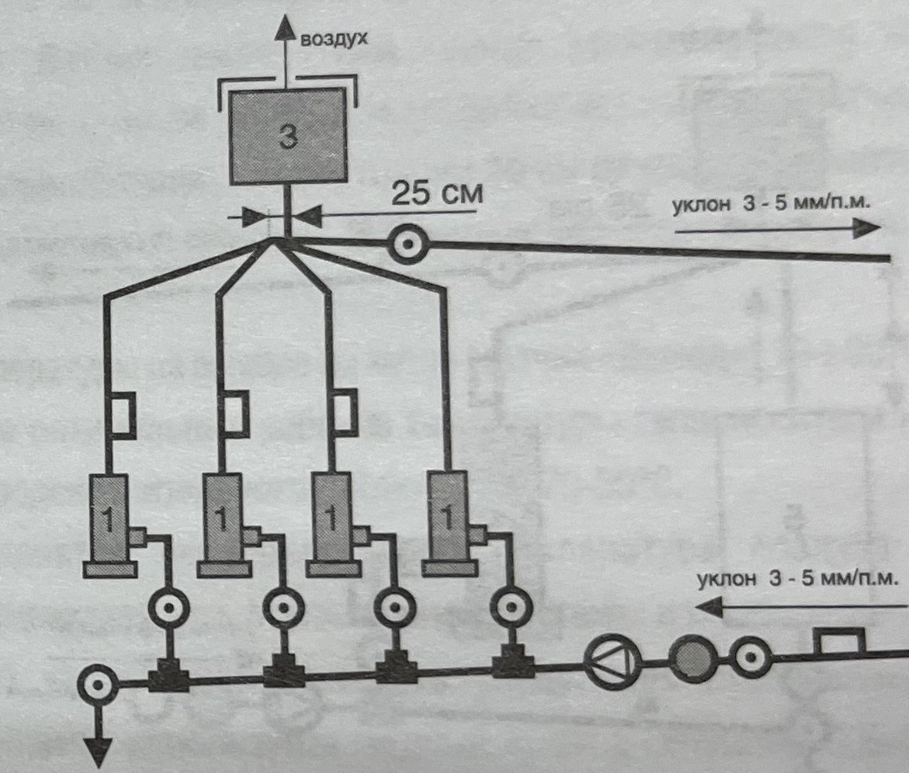
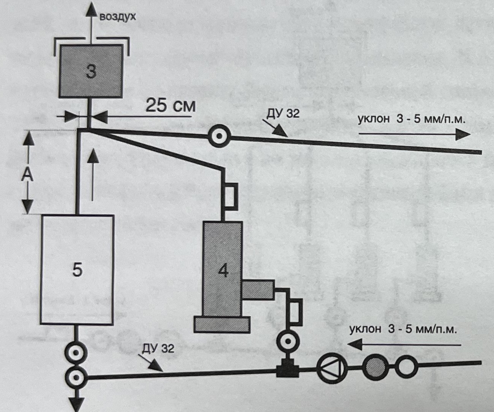
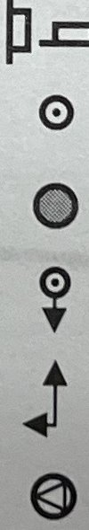
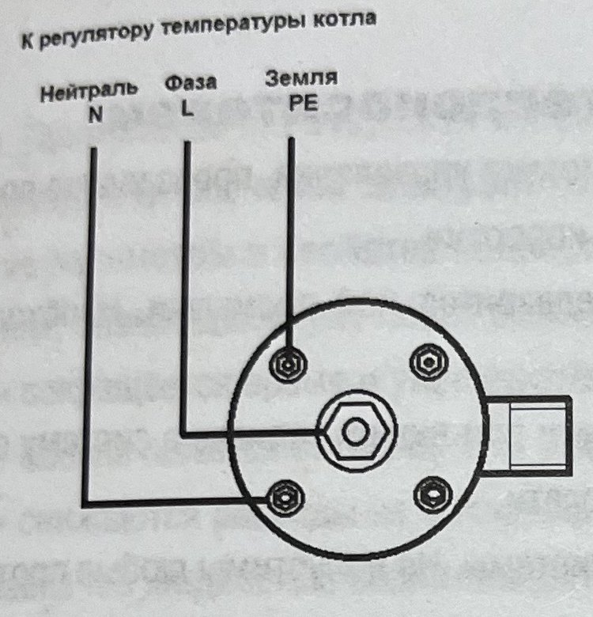
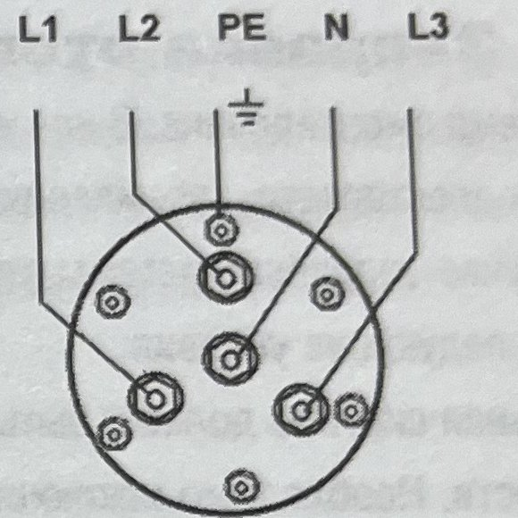
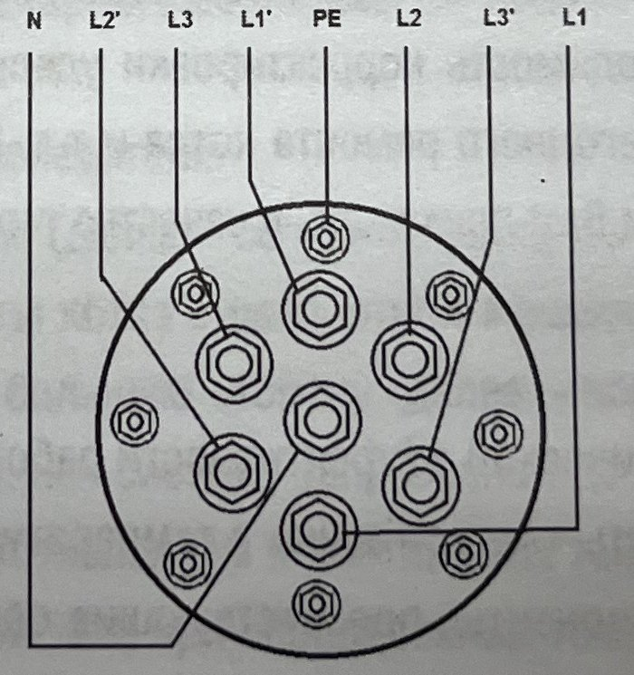

# ZAO „Firma GALAN” elektródás kazánok. Kezelési útmutató

<!-- page 1 -->

**GALAN ™ GALAN**
WARMWORLD · A MELEG VILÁGA

**ELEKTRÓDÁS VÍZMELEGÍTŐ KAZÁNOK**

**ÚTMUTATÓ**
elektródás kazánok fűtési rendszerekben történő alkalmazásához és üzemeltetéséhez

| OCSAG | GEJZER | VULKÁN |
|---|---|---|
| __6__ kW *(kézzel bekarikázva)* | ___ kW | ___ kW |

RUS · Önkéntes tanúsítás (RST jel)

---

<!-- page 3 -->
## Tartalomjegyzék

Bevezetés .......................................................... 4
Műszaki jellemzők: ZAO „Firma Galan” kazánjai ..................... 7
A kazánok felépítése .............................................. 9
Az elektródás kazánok előnyei ..................................... 10
Ajánlott szállítási készlet ........................................ 13
Az elektródás kazán beépítése (szerelése) a fűtési rendszerbe ...... 14
Szigorúan tilos .................................................... 17
A kazánok villamos szerelése (automatika) ......................... 18
A fűtési rendszer feltöltése hőhordozó közeggel .................... 24
A beállítás (korrekció) elvégzése ................................. 26
A kazán bekapcsolása .............................................. 29
Karbantartási és megelőző munkák. A rendszer átmosása ............. 30
A kazán javítása .................................................. 31
A kazán működésének szemrevételezése ............................ 33
Éves munkák, amelyek az elektromos biztonságot és az automatikai eszközök megbízhatóságát biztosítják ..................................... 35
Tűzbiztonság ..................................................... 36
Az elektródás kazánok szállítása és tárolása ....................... 36
A fűtési rendszer lehetséges hibái és elhárításuk módjai ........... 37

3

---

<!-- page 4 -->
Ez a kézikönyv az elektródás kazánok fűtési rendszerekben történő gyakorlati alkalmazásához szükséges alapvető információkat tartalmazza. Gazdasági és műszaki hatékonyság összességét tekintve párját ritkítja – ideértve a KPD-t, a beszerelés és a javítás egyszerűségét, 1 m³ helyiség fűtésének költségét, a kazán 1 kW teljesítményére jutó anyagigényt stb. –, az elektródás kazánok alkalmazása mind az alkalmazási területek, mind a felhasználás mértéke szerint továbbra is magabiztosan bővül.

A kézikönyv az elektródás kazánok, a vezérlő automatikai rendszerek beszerelésével, vezérlésével és ellenőrzésével, a beüzemelési munkákkal, a karbantartással és javítással foglalkozó szakembereknek, valamint a kazántulajdonosoknak készült.

Hálásak leszünk mindazoknak, akik a kézikönyvvel kapcsolatos észrevételeiket és javaslataikat a ZAO „Firma Galan” címére küldik.

Minden jog fenntartva. A kézikönyv egyetlen része sem sokszorosítható semmilyen formában a ZAO „Firma Galan”, mint szerzői jogtulajdonos írásos engedélye nélkül.

## Bevezetés

Az elektródás kazán az energiatakarékos fűtéstechnika egyik élvonalbeli, széles körben és magabiztosan alkalmazott vívmánya, amely a hosszú évek sikeres üzemeltetési tapasztalatai szerint egyszerű, megbízható és üzem közben biztonságos termék. Ez a hazai védelmi ipar egyik legjobb vívmányának békés célú alkalmazásának eredménye. Az elektródás kazánok hatásfoka eléri a 98%-ot. Évek óta a ZAO „Firma Galan” kazánjait sikerrel alkalmazzák gyakorlatilag Oroszország minden régiójában, valamint a közeli és távoli külföldi országokban.

4

---

<!-- page 5 -->
## Tisztelt Vásárló!

Annak érdekében, hogy kazánjaink előnyeit teljes mértékben kihasználhassa, és elkerülje a kellemetlen hibákat a fűtési rendszer szerelésekor, a kazán felszerelésekor, az üzembe helyezéskor és a későbbi üzemeltetés során, kérjük, előzetesen figyelmesen ismerkedjen meg ezzel a kézikönyvvel. A kézikönyv tartalmazza a kazán jellemzőire, felépítésére, működési elvére, alkalmazására, a kazán beszerelésének szabályaira, a fűtési rendszer szerelésére vonatkozó alapvető követelményekre, az üzemeltetésre, a javításra, a biztonsági előírásokra, valamint a munkadokumentáció kitöltésére és vezetésére vonatkozó információkat, stb.

A kazánokat lakóházak fűtésére tervezték, beleértve a nyaralókat, kerti házakat, a többemeletes többlakásos házakat, garázsokat, fürdőket, a kommunális-szolgáltató, kereskedelmi, közéleti, ipari és mezőgazdasági rendeltetésű helyiségeket és épületeket, valamint más építményeket, ahol nincs központi fűtés, vagy az nem hatékony.

A ZAO „Firma Galan” átfolyós típusú, elektródás elektromos fűtőkazánjai, a „Ocsag”, „Gejzer” és „Vulkán” sorozatok (a továbbiakban: kazán) kizárólag zárt fűtési rendszerekben alkalmazhatók, a rendszerből nem vételezhető melegvíz háztartási, ipari vagy bármilyen más célra, természetes és kényszerkeringetéssel (keringtető szivattyú alkalmazásával) működő hőhordozó-közeg-körforgással, az ajánlott legkedvezőbb üzemmódban: a kazán bemenő hőmérséklete 35÷45 °C.

Ezeket a kazánokat a ZAO „Firma Galan” fejlesztette ki, és kizárólag Oroszországban gyártják.

A fűtött helyiségek beállított hőmérsékletét az automatika eszközei, köztük a hőmérséklet-szabályozó tartja fenn.

Üzemmód: folyamatos.

5

---

<!-- page 6 -->
A kazán normál működéséhez az alábbi feltételek szükségesek:

- a helyiség hőmérséklete, amelyben a kazán fel van szerelve: határérték +7 °C-tól +40 °C-ig, üzemi érték +10 °C-tól +35 °C-ig, ha nincs egyéb követelmény;
- a levegő relatív páratartalma 20 °C-on: legfeljebb 75%;
- a környezet: nem robbanásveszélyes, nem tartalmaz a fémet és szigetelést károsító agresszív gázokat és gőzöket, valamint olyan mennyiségű ipari port, amely a kazán működését károsítja vagy zavarja.

A kazánok szerkezetében nincsenek éghető anyagok, ezért kazánjaink tűzbiztonságosak.

A kazánok műszaki feltételei (TU): TU3468-0001-17289826-12;

Megrendelési jelölés: – Elektródás kazán „Galan-xxxx №” (xxxx – a kazán megnevezése).

Megjegyzés: № – a kazán teljesítménye az 1. sz. táblázat szerint.

Példa: – Elektródás kazán „Galan-Ocsag 6” – a kazán megnevezése „Ocsag”, teljesítménye 6 kW.

**Az 1. sz. táblázatban szereplő „Ocsag”, „Gejzer” és „Vulkán” sorozatú kazánok valamennyien tanúsítottak.**

**Megfelelőségi tanúsítvány: №ROSS RU.ME71.H00215.**

**Tanúsító szerv: OS EI ANO ET 109052, Moszkva, Nyizsnyegorodszkaja utca 29.**

**Önkéntes tanúsítás.**

6

---

<!-- page 7 -->
## A ZAO „Firma Galan” kazánjainak műszaki jellemzői

| № | Jellemzők | A kazán megnevezése | | | | | | | | |
|---|---|---|---|---|---|---|---|---|---|---|
| | | Ocsag-2 | Ocsag-3 | Ocsag-5 | Ocsag-6 | Gejzer-9 | Gejzer-15 | Vulkán-25 | Vulkán-36 | Vulkán-50 |
| 1. | A fűtött helyiség térfogata (m³) | 80 | 120 | 175 | 200 | 340 | 550 | 850 | 1200 | 1650 |
| 2. | Névleges felvett teljesítmény (kW) | 2 | 3 | 5 | 6 | 9 | 15 | 25 | 36 | 50 |
| 3. | Névleges feszültség +-10% (V) | 220 | 220 | 220 | 220 | 380 | 380 | 380 | 380 | 380 |
| 4. | A kazán maximális árama fázisonként (A), frekvencia 50 Hz | 9,1 | 13,7 | 22,7 | 27,3 | 13,7 | 22,7 | 37,9 | 2x27,3 | 2x37,9 |
| 5. | Az automatika névleges árama. Elektromechanikus kivitel (A) | 10 | 16 | 25 | 32 | 3x16 | 3x25 | 3x40 | 2x3x32 | 2x3x40 |
| 6. | A csatlakozó vezeték rézerének keresztmetszete (mm²): 380 V | 4 | 4 | 4 | 6 | | | | | |
| | 220 V | | | | | 4 | 4 | 6 | 2x6 | 6 |
| 7. | Ajánlott hőhordozó-közeg térfogata a fűtési rendszerben (l) | 20–40 | 25–50 | 30–60 | 35–70 | 50–100 | 100–200 | 150–300 | 200–400 | 300–500 |
| 8. | A kazán fűtési rendszerhez csatlakoztató muffok névleges átmérője (mm). A „bemenet” és „kimenet” csonkok átmérője (mm) | 25 | 25 | 25 | 25 | 32 | 32 | 32 | 32 | 32 |

**1. sz. táblázat**

<!-- megjegyzés: a 6. sorban a 380 V feliratú sor az Ocsag-típusokhoz, a 220 V feliratú sor a Gejzer–Vulkán típusokhoz tartozik, az eredeti szerint -->

7

---

<!-- page 8 -->
**1. sz. táblázat (folytatás)**

| № | Jellemzők | A kazán megnevezése | | | | | | | | |
|---|---|---|---|---|---|---|---|---|---|---|
| | | Ocsag-2 | Ocsag-3 | Ocsag-5 | Ocsag-6 | Gejzer-9 | Gejzer-15 | Vulkán-25 | Vulkán-36 | Vulkán-50 |
| 9. | Áramütés elleni védelmi osztály | 1 | 1 | 1 | 1 | 1 | 1 | 1 | 1 | 1 |
| 10. | Nedvességvédelmi kialakítás | IP X 3, permetálló | | | | | | | | |
| 11. | Hossz (mm) | 315 | 315 | 315 | 315 | 360 | 410 | 460 | 570 | 570 |
| 12. | Tömeg (kg) | 1,5 | 1,55 | 1,6 | 1,65 | 5,0 | 5,3 | 5,7 | 11,0 | 11,5 |

A ZAO „Firma Galan” által gyártott, a jelen táblázatban felsorolt „Ocsag”, „Gejzer” és „Vulkán” sorozatú valamennyi elektródás kazánhoz hőhordozó közegként kizárólag az alábbiak használhatók:

– „Argus-Galan” alacsony fagypontú folyadék, fagyáspont: –40 °C. Élettartama legalább 5 év, jótállási ideje 1 év. Habzást gátló, korróziót és vízkőképződést akadályozó speciális adalékanyagokat tartalmaz (a továbbiakban: n/f folyadék);

– ivóvíz (SanPiN 2.1.4.559-96), desztillált, olvadt hóból, esővízből nyert (szűrt) víz, amelynek fajlagos ellenállása (a továbbiakban: ellenállás) legalább 3000–3200 Ω·cm 15 °C-on;

**FIGYELEM!**

**Szigorúan tilos hőhordozó közegként olyan alacsony fagypontú folyadékokat (fagyálló folyadékokat) használni, amelyeket nem elektródás kazánokhoz szántak. Például „Toszol”, „Arktika”, „Tvoj Dom” stb.**

A ZAO „Firma Galan” folyamatosan fejleszti kazánjait, ezért jellemzőik kismértékben eltérhetnek az ebben a táblázatban közöltektől.

8

---

<!-- page 9 -->
## A kazánok felépítése

A ZAO „Firma Galan” a teljesítménytől függően két csoportba tartozó kazánokat gyárt: egyfázisúakat és háromfázisúakat:

- egyfázisú: – „Ocsag-2”, „Ocsag-3”, „Ocsag-5” és „Ocsag-6”;
- háromfázisú: – „Gejzer-9”, „Gejzer-15”, „Vulkán-25”, „Vulkán-36”, „Vulkán-50”.

**Az egyfázisú kazánok a következőkből állnak:**

- fém házból, a hőhordozó közeg bemenő és kimenő csonkjaival, valamint az elektródás szerelvény rögzítésére szolgáló karimából. A ház egyben a második elektródaként és az ionizációs kamraként is működik;
- karimából álló elektródás szerelvényből, rúdelektródával, áramvezetővel és légmentesen záró átvezető szigetelővel. Az egyfázisú kazánok karimáján alul található: középen a fázis-kapocs, oldalt a nullavezető kapocs és a földelővezeték kapocs;
- védőburkolatból.

**A háromfázisú kazánok a következőkből állnak:**

- fém házból, a hőhordozó közeg bemenő és kimenő csonkjaival. A ház egyben az ionizációs kamra funkcióját is ellátja;
- alaplemezből, amelyen a kazán teljesítményétől függően 4 vagy 7 elektróda van, áramvezetőkkel és légmentesen záró átvezető szigetelőkkel;
- védőburkolattal ellátott kapocscsoportból.

A kazánok működési elve azonos, és alább kerül ismertetésre.

9

---

<!-- page 10 -->

## Az elektródás kazánok előnyei

A ZAO „Firma Galan” kazánjait kizárólag Oroszországban gyártják (8 típus, 1. sz. táblázat). Ezek nemcsak olcsóbbak, mint a teljesítményben hasonló, más típusú kazánok, a külföldiek is beleértve, hanem számos jelentős előnyük is van:

Jelentős energiamegtakarítás az elektródás kazánok rendkívül magas hatásfokának (KPD) köszönhetően, amely eléri a 98%-ot, ami jóval magasabb, mint a meglévő, más típusú fűtőkazánoké. Ezt az elektromos energia közvetlen átalakítása biztosítja hőenergiává, a hőhordozó közegben: az elektromos áram a hőhordozó közegen halad át, a molekulák ionizációja révén. Ennek során a hőhordozó közeg hőmérséklete és vezetőképessége nő, az elektródától az elektródáig folyó áram erősödik, a kazán pedig gyorsan eléri a névleges teljesítményt.

Az energiafogyasztás 20-40%-os megtakarítása az elektródás kazánok gyors működésének és az automatika alkalmazásának köszönhető: a ZAO „Firma Galan” elektronikus hőmérséklet-szabályzói: „Navigator”, „Komfort”, a mobilhálózaton keresztüli távvezérlés: „Galan GSM”, valamint az automatika elektromechanikus változata (MRT-15).

---

<!-- page 11 -->

Egyszerű felszerelés, kis méret és alacsony tömeg jellemzi az elektródás kazánokat. Például a 6 kW teljesítményű kazán 1,65 kg, a 25 kW-os 5,7 kg.

A kazánjaink beépíthetők a korábban kiépített fűtési rendszerekbe (ha betartják az ajánlásainkat), többek között második tartalék kazánként is (a kazán párhuzamos csatlakoztatásával). Lásd a 3. sz. ábrát. A tartalék kazán teljesítményének meg kell felelnie a fűtött helyiségek méretének és hőszigetelésük minőségének, valamint a fűtési rendszerben lévő hőhordozó közeg mennyiségének (1. sz. táblázat).

Ha a tartalék kazánt működő fűtési rendszerbe telepítik, az alábbiakat kell tenni:

- alaposan, a „Galan-Protektor” korróziógátló inhibitor alkalmazásával átmosni a rendszert;
- megszűrni a hőhordozó közeget;
- intézkedni annak megakadályozására, hogy szennyeződés kerüljön a kazánba a fűtési rendszerből: szűrőket felszerelni.

A fűtési rendszer teljesítménye többszörösére növelhető (a fűtött helyiségek térfogatának megfelelően) nagyszámú kazán párhuzamos csatlakoztatásával. Például 8 darab, egyenként 25 kW-os kazán csatlakoztatása a fűtési rendszer teljesítményét 200 kW-ra növeli. (2. sz. ábra)

---

<!-- page 12 -->

**Az elektródás kazánok alkalmazása tilos:**

- „közvetlen” vízmelegítésre, amikor a víz tóból, artézi kútból, kútból, vezetékes hálózatból, folyóból stb. „közvetlenül” jut a kazánba. A kazánjaink zárt rendszerű fűtési rendszerekben való használatra készültek, amelyekben a víz zárt fűtési körben kering. A hőhordozó közegként használt víznek pontosan meg kell felelnie a kazán névleges adatainak, különben a kazán meghibásodik. A vizet a fűtési rendszerből a használati melegvíz-ellátáshoz sem szabad elvenni:
- „meleg padlók” fűtésére, mert ilyen esetben a szükséges hőmérséklet lényegesen alacsonyabb az elektródás kazán optimális üzemi hőmérsékleténél. Emiatt a kazán nem éri el a névleges teljesítményét. „Meleg padlókhoz” ezért nagy megbízhatóságú, modern TEN-es (fűtőbetétes) kazánok alkalmazását javasoljuk: a ZAO „Firma Galan” gyártmányú Ocsag-Turbo, Gejzer-Turbo és Vulkán-Turbo típusokat.

**Nem ajánlott:**

- elektródás kazánok alkalmazása olyan fűtési rendszerekben, amelyekben nagy méretű (nagy térfogatú) fűtőtestek vannak: nagy átmérőjű csövekből készült radiátorok, öntvényradiátorok stb. Ebben az esetben is a TEN-es kazánok alkalmazását javasoljuk: a ZAO „Firma Galan” gyártmányú Ocsag-Turbo, Gejzer-Turbo vagy Vulkán-Turbo típusokat.

Ha azonban a körülmények miatt nincs más lehetőség, és elektródás kazánt alkalmaz, biztosítani kell, hogy a rendszerbe töltött hőhordozó közeg mennyisége megfeleljen a kazán teljesítményének (1. sz. táblázat). Öntvényradiátorok alkalmazása esetén ezen felül a „visszatérő” ágba további szűrőket kell beépíteni: durva szűrőt és iszapfogót (leválasztót), hogy megelőzzék azt a helyzetet, amikor a fűtőtestek belsejéből származó öntőmag-homok maradványai a hőhordozó közeggel a kazánba kerülnek, és tönkreteszik azt.

---

<!-- page 13 -->

...a fűtőtestek belső üregeiből származó öntőmag-homok maradványai a hőhordozó közeggel együtt a kazánba jutnak, és tönkreteszik azt. Ennek megelőzése érdekében az öntvényradiátorokat a rendszerbe építés előtt alaposan át kell mosni.

## Ajánlott szállítási készlet

Kazán összeszerelve – 1 db

Az elektródás kazánok fűtési rendszerekben történő üzemeltetésének és alkalmazásának útmutatója – 1 db

\*Automatikai rendszer – 1 készlet

\*\* Az automatika üzemeltetési útmutatója – 1 példány

Csomagolás – 1 db

**Megjegyzés:**

\*A ZAO „Firma Galan” által ajánlott fő vezérlőeszköz a kétcsatornás „Navigator” elektronikus hőmérséklet-szabályzó. A vevő kívánságára az alábbi kapcsolási rajzok szerint elektromos berendezéseket is beszerelhet.

**A kazánra, amelyet ezen automatikus vezérlő- és felügyeleti rendszer nélkül vásároltak, a jótállás nem terjed ki.**

Az automatikus vezérlő- és felügyeleti rendszer ára nem része a kazán árának.

\*\* Az elektromechanikus automatika változatának útmutatója kivételével, mivel az a jelen üzemeltetési útmutató része.

A vevőnek ajánlott automatikai változat összetétele változhat.

---

<!-- page 14 -->

## Az elektródás kazán fűtési rendszerbe történő telepítése

**A fűtési rendszerekre vonatkozó tervezési, a kazánok és az automatika telepítési munkái, az elektromos hálózatra történő csatlakoztatás (beleértve a földelést is), az üzembe helyezés, a javítás, az állapot hivatalos felülvizsgálata, a vizsgálat, csak olyan szervezet (cég) végezheti, amely rendelkezik az ilyen munkák elvégzésére jogosító megfelelő engedéllyel.**

A fenti munkák elvégzésekor, a fűtési rendszerekre vonatkozó dokumentáció elkészítésekor, valamint az üzemeltetés során az alábbiakat kell betartani:

- „Elektromos berendezések építésének ágazatközi szabályai” (PUE);
- „a fogyasztói villamos berendezések műszaki üzemeltetési szabályai (PTE)”;
- „Elektromos berendezések biztonságos üzemeltetésének szabályai”;
- „Elektromos kazánok és elektrókazánok kialakítására és biztonságos üzemeltetésére vonatkozó szabályok”;
- Jelen üzemeltetési útmutató.

Be kell tartani továbbá a vonatkozó SNiP előírásait és az „Orosz Föderáció tűzbiztonsági szabályait” is.

**A kazánok csatlakoztatásához, az automatikus vezérlőrendszerek fűtési rendszerekbe történő telepítéséhez, valamint ezek karbantartásához, beleértve a javítást is, megfelelő képesítéssel rendelkező villanyszerelő vagy KIPiA (mérés- és automatikai) szakemberek szükségesek, akik minősítéssel rendelkeznek, 1000 V-ig terjedő elektromos berendezésen való munkavégzésre jogosultak, és legalább 3-as villamos biztonsági csoporttal rendelkeznek. A fűtési rendszerek szereléséhez, üzemeltetéséhez és javításához fűtéstechnikai szakemberek szükségesek.** A fenti szakembereknek ismerniük kell az „Elektromos kazánok és elektrókazánok kialakítására és biztonságos üzemeltetésére vonatkozó szabályokat” és a jelen üzemeltetési útmutatót.

---

<!-- page 15 -->

A korróziógátló inhibitorral, a fagyálló folyadékkal és a felületek átmosására, tisztítására szolgáló szerekkel végzett munkák során ismerni és betartani kell azok biztonságos alkalmazásának szabályait.

**A felsorolt munkák elvégzése után a munkát végző szervezet (cég) bejegyzést készít a Jegyzékben (2. sz. melléklet), amelyet a munkák felelős végrehajtója és a szervezet bélyegzője hitelesít.**

**Figyelem! A jótállási kötelezettségek a fenti követelményeknek megfelelően, a munkák megfelelő dokumentálásával telepített kazánra vonatkoznak. Olyan kazánra, amelyet nem a terv szerint vagy nem jogosult szervezet, illetve nem minősített szakemberek telepítettek, a jótállás nem terjed ki.**

A kazán működésének szemmel történő felügyeletét legalább 18 éves, a megfelelő oktatásban részesült személyek végezhetik, akik ismerik a jelen útmutatót, a kazán felépítését és a működésének biztonságos felügyeletére vonatkozó szabályokat.

**Csatlakozás az energiaszolgáltató elektromos hálózatához.**

Ha a rendelkezésre álló teljesítmény nem elegendő, a kazán csatlakoztatását az előírt módon kell bejelenteni.

Figyelembe kell venni, hogy ez a csatlakozási eljárás az elektromos kazánok minden más típusára is vonatkozik, és nem az elektródás kazánok sajátossága.

**Földelés.**

A kazán fűtési rendszerhez történő telepítésének időpontjára a földelésnek teljesen elkészültnek és vizsgáltnak kell lennie. A kazán és a fűtési rendszer földelési ellenállása legfeljebb

---

<!-- page 16 -->

4 Ohm. Földelővezetőként 4-6 mm² keresztmetszetű rézvezeték használandó (1. sz. táblázat).

A védőföldelés kialakításának meg kell felelnie a PUE és az „Elektromos kazánok és elektrókazánok kialakítására és biztonságos üzemeltetésére vonatkozó szabályok” előírásainak.

A kazán és a fűtési rendszer minden olyan fémes, feszültség alatt nem álló része, beleértve a hideg („visszatérő”) és a meleg hőhordozó közeget szállító fémcsöveket is, földelve kell legyen.

A földelővezetők épületbe vagy építménybe történő bevezetési helyét jelzőtáblával kell megjelölni.

**Földelők**

A földelőknek meg kell felelniük a PUE követelményeinek.

A földelő kialakításának és kivitelezésének biztosítania kell a kazán és a fűtési rendszer követelményeknek megfelelő földelési ellenállását: legfeljebb 4 Ohm.

A földelő állapotának időszakos felülvizsgálatának határideje: 12 év.

A korróziós kopás nem haladhatja meg az 50%-ot.

Tilos a földelő szerkezetét festeni, illetve korrózió ellen eltávolítható vagy állandó szigetelő (dielektromos) bevonattal védeni, például műanyag, gumi vagy tok formájában.

**A kazán fűtési rendszerbe történő telepítése (beszerelése)**

A telepítés előtt el kell végezni a kazán szemrevételezését, és ellenőrizni kell a teljes felszereltségét.

A kazánt a fűtési rendszerbe szigorúan függőlegesen kell beépíteni. Az elektromos hálózathoz való csatlakoztatás kapocsrendszerének (a kazán áramvezetőinek) a külső hatásoktól és a véletlen érintéstől védő burkolattal (sapkával) védve, alul kell elhelyezkednie. **A kazán csonkjainak és a fűtési rendszer csővezetékeinek összekötése legalább a csonkok névleges átmérőjével (DN) megegyező méretű szerelvényekkel (csőidomokkal) történik.**

---

<!-- page 17 -->

**a kazán kimenete után és a projekt szerint.** Ha a rendszerben műanyag csövek vannak, a kazán kimenete után 2-2,5 métert a nem horganyzott („fekete”) fémcsövekre kell cserélni.

A fűtési rendszer tervezésekor elő kell írni a következőket:

• a kazánt a lehető legalacsonyabban kell elhelyezni a fűtőtestekhez képest, mert ez növeli a nyomást a kazán kimenetén. Ilyenkor kívánatos, hogy a kazán és a padló közötti függőleges távolság elegendő legyen az elektródacsoport kazánból való szabad kiszereléséhez, valamint a kazán belső felületeinek átvizsgálásához és tisztításához. A kazán feletti függőleges felszálló ág átmérőjének, akárcsak a fűtési rendszer valamennyi csővezetékének átmérőjének szigorúan a fűtési rendszer projektje szerint kell lennie. A kazán feletti függőleges felszálló ág magassága legalább 2 m. Ez egyik előfeltétele annak, hogy keringtető szivattyú ne legyen szükséges. Szereléskor a kazánt a falhoz kell rögzíteni, függetlenül attól, hogyan csatlakozik a fűtési rendszerhez.

Az 1., 2. és 3. ábrán néhány alapvető fűtési rendszer-kialakítási séma látható.

A fűtési rendszer karbantartásának megkönnyítése érdekében a csővezetéken, közvetlenül a tágulási tartály után és a kazán bemeneti csonkja előtt elzáró csapokat kell felszerelni (lásd 1., 2., 3. ábra).

Zárt típusú fűtési rendszer szerelésekor megengedett a tágulási tartály elé zárószerelvény beépítése, feltéve, hogy a kazán után közvetlenül biztonsági csoport található. Ilyen esetben zárt típusú tágulási tartályt a kazán előtti visszatérő ágra javasolt szerelni.

## Szigorúan tilos

Bármilyen csap, bármilyen elzáró vagy szabályozó szerelvény beépítése a kazán kimeneti csonkja és a nyitott típusú fűtési rendszer tágulási tartálya közötti csővezeték-szakaszon.

---

<!-- page 18 -->

## Elektromos szerelés kazánoknál (automatika).

A 3 fázisú kazánokat a 4 vezetékes, 3 fázisú, 380 V feszültségű, 50 Hz ipari frekvenciájú villamos hálózatra kell csatlakoztatni: N – nulla vezető, PE – védőföldelő vezető. Az N és PE vezetők el vannak választva. Az egyfázisú kazánoknál egyfázisú, 220 V feszültség szükséges. N – nulla vezető. PE – védőföldelő vezető. Az N és PE vezetők el vannak választva. A villamos hálózatra való csatlakoztatást a fűtési rendszer projektje szerint, és a ZAO „Firma Galan” által választott automatika-rendszernek megfelelően végezze. **A „fázis – nulla – föld” elrendezés betartása kötelező.** A csatlakozó vezetékek keresztmetszete legyen egységes, és ne legyen kisebb a kazánjához tartozó 1. táblázatban (elektromechanikus automatika-változat), illetve a kiválasztott elektronikus fűtésautomatikai rendszer használati útmutatójában megadott értéknél.

---

<!-- page 19 -->

1. ábra: Fűtési rendszer felső elosztással.

**Jelmagyarázat (1. ábra):** 1 – elektródás kazán; 2 – radiátor; 3 – tágulási tartály; A – függőleges felszálló ág a kazán felett; levegő; 25 cm; DN 32 (névleges átmérő); lejtés 3-5 mm/fm (folyóméterenként).

2. ábra: Párhuzamos csatlakoztatás.

**Jelmagyarázat (2. ábra):** 1 – elektródás kazán (négy egység); 3 – tágulási tartály; levegő; 25 cm; lejtés 3-5 mm/fm (folyóméterenként).

---

<!-- page 20 -->

3. ábra: Tartalék elektródás kazán csatlakoztatása.

**Jelmagyarázat (3. ábra):** 3 – tágulási tartály; 4 – tartalék elektródás kazán; 5 – főkazán (szilárd, folyékony vagy gáznemű tüzelőanyaggal működő); levegő; 25 cm; DN 32; lejtés 3-5 mm/fm (folyóméterenként); A = függőleges felszálló ág a kazán felett.

| Jel. sz. | Berendezés megnevezése |
|---|---|
| 1. | Elektródás kazán. |
| 2. | Radiátor. |
| 3. | Tágulási tartály. |
| 4. | Tartalék elektródás kazán. |
| 5. | Főkazán, szilárd, folyékony vagy gáznemű tüzelőanyaggal működő. |

## Jelmagyarázat

Szimbólumok sorrendben (felülről lefelé): felerősíthető (rászerelhető) termosztát; csap; szűrő (ülepítő, „iszapfogó”, mechanikus); csap a rendszerből a hőhordozó közeg leeresztéséhez; levegőtelenítő csap; keringtető szivattyú.

- felerősíthető (rászerelhető) termosztát (a továbbiakban: érzékelő);
- csap;
- szűrő (ülepítő, „iszapfogó”, mechanikus);
- csap a rendszerből a hőhordozó közeg leeresztéséhez;
- levegőtelenítő csap;
- keringtető szivattyú. Teljesítmény: 70 vagy 100 W;

A – függőleges felszálló ág a kazán felett, magassága legalább 2 m, DN 40 – DN 32.

---

<!-- page 21 -->

A „Galan GSM” távvezérelt mobilhálózati vezérlő- és felügyeleti rendszer, valamint a „Navigator” és „Komfort” elektronikus hőmérséklet-szabályozók használatakor, illetve az elektromechanikus változat esetén szigorúan kövesse a kezelési útmutatóban megadott csatlakozási sémákat. Pontosan tartsa be az üzemeltetésre, szerelésre és biztonságra vonatkozó követelményeket. A „bemenet” hőmérséklet-érzékelőt a rendszer utolsó radiátora után, a visszatérő ágon („obratka”) kell felszerelni, de legfeljebb 5 m-re az automatikai egységtől. A „kimenet” érzékelő a kazánból kilépő csővezetékre (függőleges felszálló ág) kerül, a kazán kimenetétől (a kazáncsonktól) mért 30 cm-re. Az érzékelőket fém csővezeték-szakaszokra kell szerelni a mérési hibák csökkentése érdekében.

A „Navigator” hőmérséklet-szabályozó hőmérséklet-szabályozási tartománya: a kazán kimenetén (kimenet-érzékelő) 10÷90 °C, a kazán bemenetén (bemenet-érzékelő) 10÷60 °C. A hőhordozó közeg ajánlott optimális üzemi hőmérséklete a kazán bemenetén 35-45 °C, a kazán kimenetén (biztonsági lekapcsolási hőmérséklet) 70-80 °C.

A „Komfort” és a „Galan GSM” szabályozóknál a fűtött helyiség levegőjének hőmérsékletét közvetlenül mérik, ami jelentősen növeli a fűtési rendszer hatékonyságát és a fűtött helyiségek komfortját. Az automatikus szabályozás gyengeáramú részének (keringtető szivattyúhoz és érzékelőkhöz való csatlakoztatás) kialakításához 0,5–2,5 mm² keresztmetszetű rézvezetéket használjon. (Réz) A vezeték típusát a fűtési rendszer tervében és az automatikai eszközök dokumentációjában kell feltüntetni. Ha többerű rézvezetéket használ, alkalmazzon kábelsaru-t, de ne ónozza a vezeték végét, mert ez rossz érintkezést okozhat.

**A „Navigator” kétcsatornás elektronikus hőmérséklet-szabályozón keresztüli villamos csatlakozási sémák a „Navigator” kezelési útmutatójában találhatók.**

---

<!-- page 22 -->

## Elektromechanikus automatika-változat

A legfeljebb 15 kW teljesítményű kazánokhoz az MRT-15 mechanikus hőmérséklet-szabályozó használata javasolt. A csatlakozási sémát az egység útlevele tartalmazza.

• A kazánt a villamos hálózathoz a kazán típusának és teljesítményének megfelelően csatlakoztassa (az 1. vagy a 2. sz. séma szerint), miközben a „bemenet” hőmérséklet-érzékelőt általában a visszatérő ágra szerelje. A „kimenet” hőmérséklet-érzékelőt a kazánból kilépő csővezetékre, a kazántól 30 cm-re kell szerelni.

• Az érzékelők csatlakoztatása 0,5–2,5 mm² keresztmetszetű többerű rézvezetékkel történik (réz). Az érzékelőket a mérési hibák csökkentése érdekében fém csővezeték-szakaszokra kell szerelni.

A védelmi automata a kazán villamos táplálásának be- és kikapcsolására szolgál, emellett túláram esetén automatikus védőberendezésként működik.

A mágneskapcsoló házán lévő gomb a hőrelé be- és kikapcsolására szolgál; normál üzemben a kazán táplálási áramkörének kapcsolója folyamatosan bekapcsolt (benyomott) állapotban van. Kioldása azt jelenti, hogy az áramfelvétel meghaladja a névleges értéket a kazán hibája, az elektromos kapcsolás hibája miatt, vagy azért, mert a víz elektromos ellenállása 15 °C-on 3100 Ω cm alá csökken. A hőrelé bekapcsolása a gomb megnyomásával történik.

a. Állítsa be a kazán „kimenetén” ajánlott hőmérsékletet: 65 °C÷75 °C.

b. Állítsa be a kazán „bemenetén” szükséges hőmérsékletet. Ez az érték a helyiség térfogatától, a helyiség hőszigetelésének minőségétől stb. függ, és általában 35 °C÷45 °C.

---

<!-- page 23 -->

A kazán hőmérséklet-szabályozójához

4. ábra: Egyfázisú elektródás kazánok csatlakoztatási sémája, típusok: Ocsag-2, Ocsag-3, Ocsag-5, Ocsag-6.

**Jelmagyarázat (4. ábra):** N = nulla; L = fázis; PE = föld; a kazán hőmérséklet-szabályozójához.

5. ábra: Háromfázisú kazánok csatlakoztatási sémája, típusok: Gejzer-9, Gejzer-15, Vulkán-25.

**Jelmagyarázat (5. ábra):** Csatlakozók: L1, L2, PE (védővezető, földelési jellel), N (nulla), L3. Nincs orosz felirat az ábrán.

6. ábra: Háromfázisú kazánok csatlakoztatási sémája, típusok: Vulkán-36, Vulkán-50.

**Jelmagyarázat (6. ábra):** Csatlakozók: N, L2', L3, L1', PE, L2, L3', L1. Nincs orosz felirat az ábrán.

---

<!-- page 24 -->

## A fűtési rendszer feltöltése hőhordozó közeggel

Az Ön fűtési rendszere össze van szerelve. Ebbe be van építve a kazán, az automatikus vezérlőrendszer, valamint a rendszer villamos hálózatra csatlakoztatása és földelése megtörtént. A fűtési rendszerben nincs szennyeződés, korrózió. Ebben az esetben a fűtési rendszer hőhordozó közeggel való feltöltése előzetes átmosás nélkül történik. Be kell tartani a következő feltételeket:

- a fűtési rendszert vízzel vagy n/z folyadékkal történő bármely feltöltés során feltétlenül le kell választani az elektromos hálózatról. Ki kell zárni a véletlen villamos hálózatra csatlakoztatás lehetőségét;
- a hőhordozó közeg rendszerbe töltése után azonnal ellenőrizni kell a rendszer tömítettségét. Semmilyen szivárgás nem megengedett;

A fűtési rendszer feltöltése „Argus-Galan” n/z (alacsony fagyáspontú) folyadékkal vagy vízzel lehetséges (táb. 1. sz.).

A víz hőhordozóként számos vitathatatlan előnnyel rendelkezik, például rendelkezésre áll, olcsó, környezetbarát, és jó hőfizikai tulajdonságai vannak. Ugyanakkor a víznek olyan hátrányai is vannak, mint a fűtési rendszer korróziója, a fajlagos elektromos ellenállás szükséges korrigálása a fűtési szezon során, a kazán évenkénti karbantartása stb. Ezért a víz hőhordozóként való alkalmazását nem vitatva javasoljuk, hogy hőhordozóként a korszerű „Argus-Galan” n/z folyadékot használják.

### Az „Argus-Galan” n/z folyadék

A fűtési rendszer működésének megbízhatóbbá és gazdaságosabbá tétele érdekében kifejlesztettek egy univerzális, alacsony fagyáspontú folyadékot, az „Argus-Galan” n/z folyadékot, amelynek fagypontja -40°C.

Az n/z folyadékba speciális összetevőket kevertek, amelyek megakadályozzák a habképződést és a vízkőképződést a fűtési rendszerben, valamint olyan összetevőket, amelyek feloldják a már meglévő vízkövet és lassítják a korróziós folyamatot.

Oldalszám: 24

---

<!-- page 25 -->

<!-- A RU szövegben a 24. oldalon elvágott „zii.” szó folytatása ez, a magyar fordításban nincs elvágás. -->

Az n/z folyadék alkalmazása megszabadít a fűtési rendszer „lefagyásának” veszélyétől áramszünet esetén, és jelentősen egyszerűsíti a fűtési rendszer karbantartását, mivel paraméterei és tulajdonságai teljes mértékben megfelelnek az elektródás kazánnal működő fűtési rendszer követelményeinek. Emellett jelentősen javítja a gazdasági és üzemeltetési mutatókat, többek között:

- csökken az üzembe helyezési munkák ideje, és egyszerűbbé válnak;
- biztosított a fűtési rendszer működésének stabilitása;
- csökkennek a rendszer karbantartási költségei.

A fűtési rendszer feltöltése n/z folyadékkal.

A rendszerben nincs szennyeződés, korrózió.

A mért mennyiségű n/z folyadékot a „Malis” típusú szivattyú vagy hasonló berendezés segítségével a leeresztő csapon keresztül töltik a rendszerbe. Normálisnak tekintendő a tágulási tartály 1/3-ának feltöltése, miután a rendszerből kiengedték a levegőt.

**A víz alkalmazása hőhordozóként.**

A kiindulási víz (táb. 1. sz.) fajlagos elektromos ellenállása (a továbbiakban: ellenállás) eltérhet a kazán névleges teljesítményéhez szükséges értéktől, ezért előfordulhat, hogy azt kisebb vagy nagyobb irányba módosítani kell (a továbbiakban: korrekció). Az ellenállás korrekcióját („beállítását”) azután végzik, hogy a rendszert vízzel feltöltötték, úgy, hogy a vízhez főzött sóoldatot vagy nagy ellenállású vizet adnak, és így elérik az indító (kezdő) és a maximális áram táblázatos értékeit (4. táb.) meghatározott visszatérő hőmérsékleteknél (a továbbiakban: „Bemenet”). Feltétlenül szigorúan be kell tartani a jelen Kezelési útmutató előírásait:

Oldalszám: 25

---

<!-- page 26 -->

- a kazán bemenetén (a „Bemenet” érzékelőnél) a hőmérsékletnek 15°C÷20°C között kell lennie;
- a kazán bekapcsolásának időtartama legfeljebb 30 másodperc.

**A víz vezetőképességének korrekciójának elvégzése.**

Kapcsolja be a kazánt, és 30 másodperccel később, „visszatérő” hőmérséklet 15°C÷20°C mellett, árammérővel vagy áramfogóval mérje meg az indító (kezdő) áramot. Kapcsolja ki a kazánt. Három eset lehetséges: az indító (kezdő) áram kisebb vagy nagyobb, mint a Ön kazánjához a 4. táblázatban megadott érték, vagy megegyezik a táblázatbeli értékkel.

Táblázat 4

| Sor.sz. | Típus (a kazán megnevezése) | Teljesítmény, kW | Feszültség, V | Fázisszám, F | Indító (kezdő) áram a kazánnál, „visszatérő” hőmérséklet 15°C esetén, A | Maximális áram a kazánnál állandósult üzemmódban, „visszatérő” hőmérséklet 60°C esetén, A |
|---|---|---|---|---|---|---|
| 1 | „Ocsag-2” | 2 | 220 | 1F | 4 | 9,1 |
| 2 | „Ocsag-3” | 3 | 220 | 1F | 5 | 13,7 |
| 3 | „Ocsag-5” | 5 | 220 | 1F | 10–12 | 22,7 |
| 4 | „Ocsag-6” | 6 | 220 | 1F | 15–18 | 27,3 |
| 5 | „Gejzer-9” | 9 | 380 | 3F | 6–8 A/fázis | 13,7 A/fázis |
| 6 | „Gejzer-15” | 15 | 380 | 3F | 8–10 A/fázis | 22,7 A/fázis |
| 7 | „Vulkán-25” | 25 | 380 | 3F | 12–15 A/fázis | 37,9 A/fázis |
| 8 | „Vulkán-36” | 36 | 380 | 3F | 18–24 A/fázis | 54,6 A/fázis |
| 9 | „Vulkán-50” | 50 | 380 | 3F | 24–30 A/fázis | 75,8 A/fázis |

Oldalszám: 26

---

<!-- page 27 -->

*A mért indító (kezdő) áram kisebb, mint a kazánjához a 4. táblázatban megadott érték. Az indító áram értékének korrekcióját a következőképpen végezzük:*

- tiszta főzősó-oldatot készítünk: 1 teáskanál sót 200 g meleg vízben oldunk fel. Ez hozzávetőleges mennyiség a rendszerbe töltött 100 liter vízhez. A mért indító áram és a táblázatos értéke (4. táb.) közötti különbségtől, valamint a kazán teljesítményétől és a rendszerbe töltött víz mennyiségétől függően határozzuk meg az egyszeri sóoldat-adagot, amelyet a rendszerből leeresztett 20 liter vízbe töltünk. Alaposan összekeverjük. A „Malis” típusú szivattyú segítségével a leeresztő csapon keresztül visszavezetjük a rendszerbe. Ezután a rendszerből még 20 litert leeresztünk, de sóoldat hozzáadása nélkül, majd ismét visszatöltjük a rendszerbe. Csak a keringtető szivattyú működik 20-30 percig. A szivattyú működési idejét a fűtési rendszer mérete és a rendszerbe töltött víz mennyisége is befolyásolja. Erre azért van szükség, hogy a víz paraméterei az egész fűtési rendszerben kiegyenlítődjenek.

Ezután kapcsolja be a kazánt, mérje meg az indító (kezdő) áramot a kazán bekapcsolása után 30 másodperccel, „visszatérő” hőmérséklet 15°C-20°C mellett, kapcsolja ki a kazánt, és hasonlítsa össze a mért áramot a 4. táblázatban az Ön kazánjához megadott értékkel. Ha az indító (kezdő) áram eltér a 4. táblázatban megadottól, ismételje meg a vízellenállás korrekcióját. Közben a kazán bemenetén a hőmérsékletnek 15°C÷20°C között kell lennie. Miután ezek az értékek megegyeztek, be kell kapcsolni a fűtési rendszert. A „Bemenet” érzékelőn 60°C hőmérséklet elérése után mérje meg a maximális áramot, és hasonlítsa össze a 4. táblázatban megadott értékkel. Szükség esetén végezze el a víz fajlagos elektromos ellenállásának további korrekcióját a fenti módszer szerint. Meg kell jegyezni, hogy az indító áram értéke tájékoztató (célzó) jellegű, és egyszerűsíti a víz fajlagos elektromos ellenállásának korrekcióját. Végleges feltétel, hogy a kazán maximális árama, amikor a kazán bemenetén („Bemenet” érzékelő) elérjük a 60°C hőmérsékletet,

Oldalszám: 27

---

<!-- page 28 -->

a 4. táblázatban megadott értékkel egyezzen meg, ezt követően az ellenállás korrekciója befejeződik. *A mért indító (kezdő) áram nagyobb, mint a kazánjához a 4. táblázatban megadott érték.* Olyan vizet kell hozzáadni a fűtési rendszerhez, amelynek ellenállása lényegesen meghaladja a névleges értéket. Ilyen víz a desztillált víz, valamint a tiszta, szennyeződésmentes, szűrt eső- vagy olvadt hóvíz. Alkalmazható ivóvezetékes víz is, amelynek fajlagos ellenállása nagy (táb. 1. sz.), de csak forralva. A hozzáadandó víz mennyisége a fűtési rendszerbe töltött víz térfogatától függ. A nagy ellenállású víz betöltésének sorrendje teljesen megegyezik azzal az esettel, amikor az indító (kezdő) áram vagy a maximális áram kisebb a kazánjához a 4. táblázatban megadott értéknél, azzal a különbséggel, hogy a fűtési rendszerbe töltött vízhez a főzősó-oldat helyett nagy fajlagos elektromos ellenállású vizet adunk. A rendszerbe betöltött nagy ellenállású víz mennyiségének és az ezzel egyidejűleg a rendszerből leeresztett víz mennyiségének egyenlőnek kell lennie. *Ha az indító (kezdő) áram és a maximális áram a „Bemenet” érzékelőn elért, megfelelő, 15°C–20°C hőmérsékleteknél megegyezik a 4. táblázatban az Ön kazánjához megadott értékekkel, a fűtési rendszerbe töltött víz fajlagos elektromos ellenállásának korrekcióját nem végezzük el. Ha a fűtési rendszerben nincs keringtető szivattyú, akkor a rendszerbe töltött víz ellenállásának korrekciójánál az alábbi változtatásokat kell végrehajtani:*

- az ellenállás változtatása a rendszerbe töltött víz teljes térfogatában a rendszerbe végzett egyszeri adagolások számának növelésével, a vízhez adagolt főzősó-oldat adagjainak csökkentésével, vagy a rendszerbe töltött nagy fajlagos elektromos ellenállású víz adagjainak csökkentésével érhető el;
- nagyobb mennyiségű víz keringtetése, amelyet minden olyan alkalommal, amikor főzősó-oldattal vagy nagy fajlagos elektromos ellenállású vízzel vizet adunk hozzá, a „Malis” típusú szivattyú segítségével a tágulási tartályba szivattyúzunk;

Oldalszám: 28

---

<!-- page 29 -->

Ha az elektródás kazánt tartalék kazánként használják (párhuzamos üzem, 3. ábra), **tilos**, hogy a fő kazán a hőhordozó közeget forrásig melegítse. Ez a hőhordozó közeg fajlagos elektromos ellenállásának megváltozásához, és ennek következtében az elektródás kazán vagy az automatika meghibásodásához vezethet.

## A kazán bekapcsolása

Kapcsolja be a kazánt, és az első automatikus ki- és bekapcsolásokig tartó időszakban tartson fenn a rendszer állapotára a legnagyobb figyelmet.

Tilos a kazánt bekapcsolni, ha a rendszerben megfagyott hőhordozó közeg van, vagy ha fennáll a megfagyás veszélye.

Az üzembe helyezési munkák ideje alatt a helyiség hőmérsékletének, ahol a fűtési rendszert felszerelték, legalább 15÷20°C-nak kell lennie.

Ha a fűtési rendszert és a villamos csatlakoztatási kapcsolási rajzot, beleértve az automatikát is, helyesen szerelték fel, a rendszer elkezd melegedni.

Ha az üzem kezdeti szakaszában a hőhordozó közeg „friss” víz, és a kazán teljesítménye fokozatosan csökken, az alábbiakat kell tenni:

- a kazánt ki kell venni a rendszerből, szét kell szerelni, és meg kell tisztítani az elektródák felületét, valamint a kazán belső felületét a ráragadt, szigetelő (dielektromos) tulajdonságú szennyeződésrétegtől, majd a kazánt össze kell szerelni és be kell szerelni a rendszerbe.

Oldalszám: 29

---

<!-- page 30 -->

## Javítási-megelőző munkák. A rendszer átmosása

A munkák célja a fűtési rendszer megbízható, hatékony és hosszú távú működésének biztosítása. A munkákat szakképzett személyzet végzi, a fűtési rendszert pedig le kell választani az elektromos hálózatról.

**A javítási-megelőző munkákat olyan cég (szervezet) végzi, amely rendelkezik az ilyen munkák elvégzéséhez szükséges megfelelő engedéllyel. Az elvégzett munkákról a végrehajtó a Kezelési útmutató nyilvántartásában bejegyzést készít, amelyet a munkáért felelős személy aláírásával és a szervezet bélyegzőjével hitelesít. (2. melléklet)**

A javítási-megelőző munkákat a fűtési szezon után kell elvégezni. Ezek gyakoriságát és összetételét attól függően határozzák meg, hogy a fűtési rendszerben milyen hőhordozó közeget használnak, valamint attól, hogy az üzemeltetés során, a rendszer, a kazán vizsgálata és a javítás közben milyen hiányosságok merültek fel.

**Hőhordozó: víz**

Évente, közvetlenül a fűtési szezon befejezése után az alábbiakat kell elvégezni:

- a fűtési rendszert szobahőmérsékletre kell lehűteni;
- 20 liter vizet kell leereszteni a rendszerből, és ebben a mennyiségben fel kell oldani a „Galan-Protektor” korróziógátló inhibitor adagját, amelynek mennyisége 100 liter vízre számítva 1,5 liter (a koncentrációtól függően 0,5 liter) inhibitor. Alaposan össze kell keverni, majd a „Malis” típusú szivattyú segítségével a leeresztő csapon keresztül vissza kell tölteni a rendszerbe. Ezután a rendszerből újabb 20 litert kell leereszteni, és inhibitor nélkül visszatölteni, így tovább, amíg a rendszer teljesen fel nem töltődik inhibitorral ellátott vízzel.

Oldalszám: 30

---

<!-- page 31 -->

## A kazán javítása

Ha másként nem lehet kivenni az elektródacsoportot (elektródát) a kazántestből, a kazánt le kell szerelni a fűtési rendszerről, továbbá meg kell tisztítani a kazántest belső felületeit, és meg kell győződni arról, hogy nincsenek rajta hibák.

A kazán javításakor a következőket kell elvégezni:

• ki kell venni az elektródát (egyfázisú kazán esetén), illetve az elektródacsoportot (háromfázisú kazán esetén), és át kell vizsgálni, nincs-e rajta hiba – repedés az átvezető szigetelőkben stb. –, valamint meg kell határozni az elektródák kopásának mértékét. Ha a kopás meghaladja a 40%-ot, az elektródát vagy elektródákat ki kell cserélni. Ez általában 3–5 évente egyszer történik;

31

---

<!-- page 32 -->

• gondosan megtisztítani az illeszkedő felületeket, hogy a tömítettséget a kazán összeszerelésekor és későbbi üzemeltetésekor tömítőanyagok alkalmazásával biztosítsuk;

• fémes fényig megtisztítani a kazántest belső felületeit, majd gondosan megvizsgálni azokat, nincs-e rajtuk hiba, például pontkorrózió stb.;

• összeszerelni a kazánt. A kazán összeszerelésekor szigorúan be kell tartani az elektródák egymáshoz és a testhez viszonyított egytengelyűségét (koaxialitását), azaz az elektródák és a test, valamint az elektródák egymás közötti távolságának (résnek) azonosnak kell lennie. Ki kell zárni, hogy összeszereléskor szennyeződés kerüljön a kazán belsejébe. Ellenőrizni kell a tömítettséget.

A kazánt szigorúan függőlegesen állítsa be a fűtési rendszerbe. Töltse fel a fűtési rendszert hőhordozó közeggel. A tágulási tartálynak a térfogatának 1/3-ig kell telve lennie.

A fent felsorolt munkák elvégzése után ellenőrizni kell a rendszer tömítettségét, a kazán és az automatika csavaros és elektromos csatlakozásainak meghúzását, a földelés csatlakozásának megbízhatóságát, a földelés elektromos ellenállásának értékét, és a fűtési rendszer próbaindítását kell elvégezni. A feltárt hiányosságokat, ha ez lehetséges, meg kell szüntetni.

Az ezen munkákért felelős személy a megfelelő bejegyzést elvégzi az Elvégzett munkák nyilvántartási lapján, aláírásával és a cég (szervezet) pecsétjével hitelesíti, feltüntetve annak címét és engedélyét. (2. melléklet).

**Hőhordozó közeg – alacsony fagypontú folyadék „Argus-Galan”.**

Ebben az esetben a kazánon végzett javítási-megelőző munkákat a fűtési szezonon kívül 3 évente egyszer kell elvégezni: ez a csavaros és elektromos csatlakozások meghúzásának, valamint a földelés csatlakozása megbízhatóságának ellenőrzését jelenti.

32

---

<!-- page 33 -->

A kazán javítási-megelőző munkáinak sorrendje – a rendszer átmosását kivéve – megegyezik azzal, amely akkor történik, ha a fűtési rendszerben hőhordozóként víz van, a fentebb leírtak szerint, és a biztonsági előírások betartásával.

A rendszer átmosása nem történik meg az alacsony fagypontú folyadék „Argus-Galan” esetében, mert ebben olyan összetevők vannak, amelyek gátolják a korróziót, a vízkőképződést és a habzást. A javítás előtt a kazánt alaposan ki kell mosni vízzel az alacsony fagypontú folyadékból, a szétszerelés után pedig a kazán alkatrészeit is át kell mosni.

## A kazán működésének szemrevételezéses figyelése

Ezt a feladatot 18 évesnél nem fiatalabb, a kazán működésére vonatkozó eligazítást kapott, a kazán felépítését ismerő, és a jelen útmutatót áttanulmányozó személyek végezhetik.

A kazán működése közben szemmel kell tartani a hőhordozó közeg szintjét a tágulási tartályban, és ellenőrizni kell a rendszerben lévő mennyiségét. Normál esetben a tartálynak a térfogatának 1/3-ig kell telve lennie. Ha a hőhordozó közeg szintje a tágulási tartályban a megadott szint alatt van, a rendszert kiszolgáló cég (szervezet) szakemberének a hőhordozóként használt anyagtól függően – víz vagy alacsony fagypontú folyadék – az alábbi két eljárás egyikét kell elvégeznie:

a). Hőhordozó közeg – víz.

A tágulási tartályba a normál szintig desztillált vizet vagy esővizet, hóolvadékot, tiszta, szűrt olvadékvizet, azaz 3100 Om cm-nél jelentősen nagyobb fajlagos elektromos ellenállású vizet kell utántölteni.

b). Hőhordozó közeg – alacsony fagypontú folyadék.

33

---

<!-- page 34 -->

A tágulási tartályba a normál szintig desztillált vizet vagy esővizet, hóolvadékot, tiszta, szűrt olvadékvizet, azaz 3100 Om cm-nél jelentősen nagyobb fajlagos elektromos ellenállású vizet, valamint 3:1 arányban alacsony fagypontú folyadékot kell utántölteni. Ezeket a munkákat kizárólag a fűtési rendszer elektromos hálózatról előzetesen lekapcsolt állapotában szabad elvégezni.

c). A kazán áramellátásának azonnali megszakításának esetei

A kazánt azonnal le kell kapcsolni az alábbi esetekben:

• a feszültség hiánya;

• füst, gőz jelenlétének jelei, a kazán és az automatika vezetékeinek megengedhetetlen felmelegedése;

• hőhordozó közeg szivárgása a rendszerből;

• fagyott hőhordozó közeg jelenléte a rendszerben;

• a földelő rendszer meghibásodása;

• nedvesség megjelenése a kazántesten, az automatikai készülékeken;

• a keringtető szivattyú működési zavarai.

**A fűtési rendszer működési zavarai esetén azonnal hívja ki a fűtési rendszerét karbantartó cég (szervezet) szakembereit a hiba elhárítására, és a megérkezésükig a kapott utasítások szerint járjon el.**

**Ha fennáll a rendszer „megfagyásának” veszélye, a hőhordozó közeget (vizet) öntse le tiszta edénybe.**

34

---

<!-- page 35 -->

## Az elektromos biztonságot és az automatikai eszközök megbízhatóságát biztosító éves munkák

Évente, a fűtési szezon befejezése után el kell végezni az elektromos biztonságot és az automatikai eszközök megbízhatóságát biztosító munkákat, függetlenül attól, hogy hőhordozó közegként víz vagy alacsony fagypontú folyadék van-e használatban (a munkákat a fűtési rendszer elektromos hálózatról való lekapcsolt állapotában kell végezni):

• a földelő rendszerek és az automatikai egység érintkezőinek megbízhatóságának ellenőrzése;

• a fűtési rendszer földelésének elektromos ellenállás-értékének ellenőrzése. Értéke nem haladhatja meg a 4 Om-ot;

• a kismegszakító szemrevételezése – porának eltávolítása, a csatlakozások ellenőrzése és meghúzása, mechanikus beragadások hiányának ellenőrzése, az érintkezők ellenőrzése;

• a mágneskapcsoló ellenőrzése – porának eltávolítása, szemrevételezése, tisztítása és a sorkapocs-csatlakozások meghúzása, az érintkezők állapotának ellenőrzése mechanikus beragadásra és mágneses leragadásra;

• az indítógombok szemrevételezése;

• a beépített automatikai eszközök („Isztopnyik”, „Navigator”, „Galan GSM”) szemrevételezése – porának letörlése, az érintkezők, a szerelés és a működőképesség ellenőrzése.

**A fent felsorolt munkákat villanyszerelő szakemberek vagy KIP és A (műszerész, automatikai) lakatosok végezhetik, akik legfeljebb 1000 V-os elektromos berendezésekhez rendelkeznek engedéllyel, és legalább 3. elektromos biztonsági csoporttal rendelkeznek. A munkák befejezése után a kazánnál próbaindítást kell végezni. A munkák befejezése után a munkákért felelős szakember az Elvégzett munkák nyilvántartási lapján megfelelő bejegyzést tesz, és azt aláírásával és a cég (szervezet) pecsétjével, a cím és az engedély feltüntetésével hitelesíti. (2. melléklet).**

35

---

<!-- page 36 -->

## Tűzbiztonság

Az összeszerelési, üzembe helyezési munkák és az elektródás kazán üzemeltetése során be kell tartani az „Oroszországi Föderáció tűzbiztonsági szabályait”, beleértve az alábbiakat:

**Tilos:**

• a kazán elhelyezési helyiségében cseppfolyósított, sűrített gáz palackjainak, könnyen gyulladó folyadékoknak és anyagoknak, éghető kenőanyagoknak a tárolása. Például: benzin, aceton, szkipidár, bitumen, lágy tetőfedő anyag, petróleum, kenőolajok stb.;

• ruhák szárítása a kazánon.

## Elektródás kazánok szállítása és tárolása

1. A kazánnak nem szabad sérülést mutatnia, és a szállítás során elszenvedett mechanikai és klimatikus hatások után is meg kell őriznie működőképességét.

2. A kazánok szállítása a szállítási mód bármelyikével, zárt szállítóeszközökben, az adott szállítási módra érvényes fuvarozási szabályok szerint végezhető. A szállítási feltételek a mechanikai tényezők hatása tekintetében: a GOST 23216-78 szerinti C csoport.

3. A szállítási feltételek a klimatikus tényezők hatása tekintetében: a GOST 15150-69 szerinti 5 (OZs 4) csoport.

4. A kazánok tárolási feltételei: a GOST 15150-69 szerinti 3 (ZsZ) csoport.

36

---

<!-- page 37 -->

## A fűtési rendszer működésében előforduló hibák és elhárításuk módszerei

| | | |
|---|---|---|
| 1. A kazán nem kapcsol be, a védőautomatika kiold. | Rövidzárlat az elektromos rendszerben a kazán helytelen csatlakoztatása miatt, a víz elektromos ellenállása jelentősen 3100 Om cm alatt van 15°C-on. | Hívjon villanyszerelőt, és ellenőrizze, hogy az összeszerelt elektromos kapcsolási rajz megfelel-e a jelen üzemeltetési útmutatóban közöltnek, valamint ellenőrizze az indítóáramokat. Szükség esetén végezze el a víz elektromos ellenállásának korrekcióját. |
| 2. A fűtési rendszer nem melegszik (gyengén melegszik). | A víz nagy fajlagos elektromos ellenállása. A hőhordozó közeg hőmérséklete túl alacsonyra van állítva. A kazán és a radiátorok csatlakoztatási sémája nem felel meg a jelen üzemeltetési útmutatóban közölteknek. | Szigorúan tartsa be a jelen útmutatóban a hőhordozó közegre vonatkozó ajánlásokat. Növelje a beállított hőmérséklet értékét. Hozza a csatlakoztatási sémákat és a telepítést összhangba a jelen útmutató sémáival. |
| *(a 2. ponttal összevonva)* | Légdugók a fűtési rendszerben a helytelen szerelés miatt. A kazán teljesítményének nem megfelelő a hozzá csatlakoztatott fűtőtestek (radiátorok, konvektorok stb.) teljesítményéhez képest. | Szüntesse meg a szerelési hibákat, a hőhordozó közeget a lefolyószelepen keresztül, nyomás alatt töltse be. Hozza a kazán és a fűtőtestek teljesítményét összhangba. |
| 3. A kazán a névleges teljesítményt használja, de csak a kazánhoz legközelebbi csővezeték (felszálló ág) melegszik fel. | A hőhordozó közeg keringése zavart szenved a fűtési rendszerben, légdugók vannak. | Tisztítsa meg a fűtési rendszert, és alaposan mossa át az „Galan-Protektor” inhibitor alkalmazásával. Kötelezően alkalmazzon durva szűrőt, azt rendszeresen tisztítsa, és távolítsa el a légdugókat. |
| 4. A kazán idővel fokozatosan elveszíti teljesítményét, többek között „friss víz” használatakor is. | A kazán belső felületein és az elektródákon szennyeződés, rozsda, vasoxid-pikkely stb. található. | Tisztítsa meg az elektródákat és a kazántest belső felületét fémes fényig. |

37
