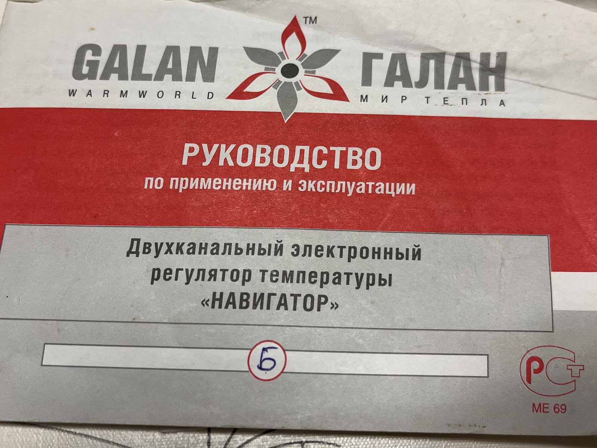
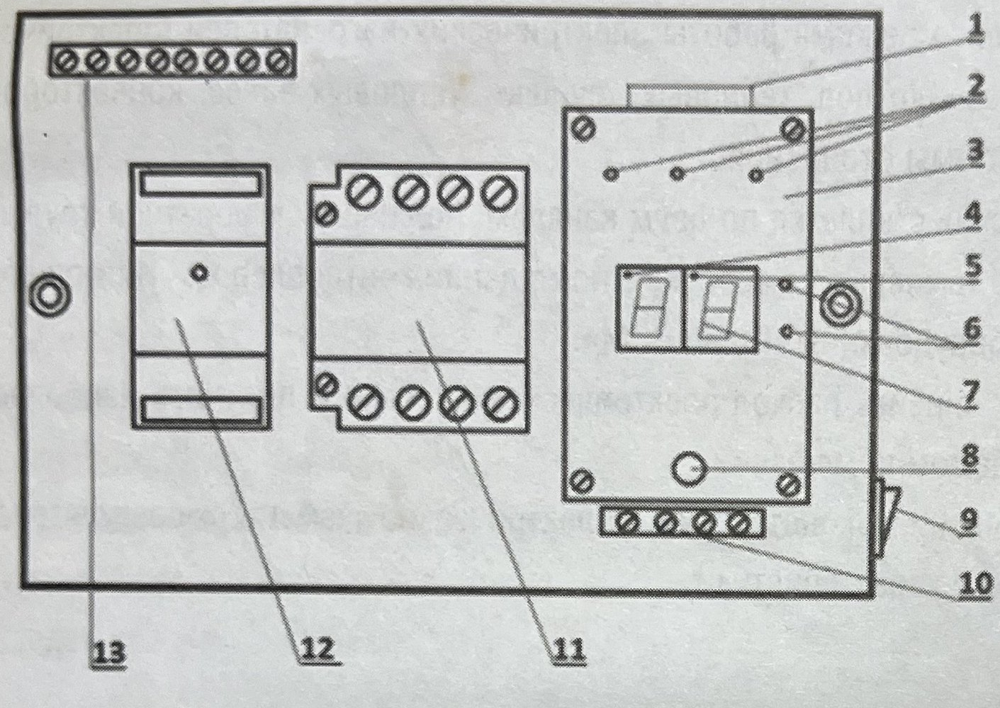
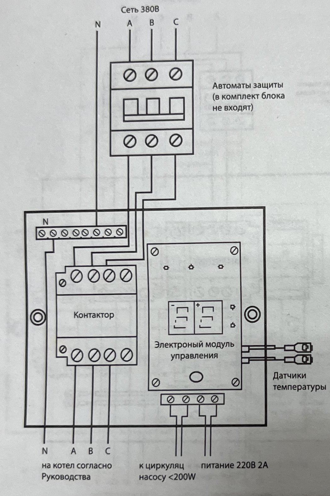
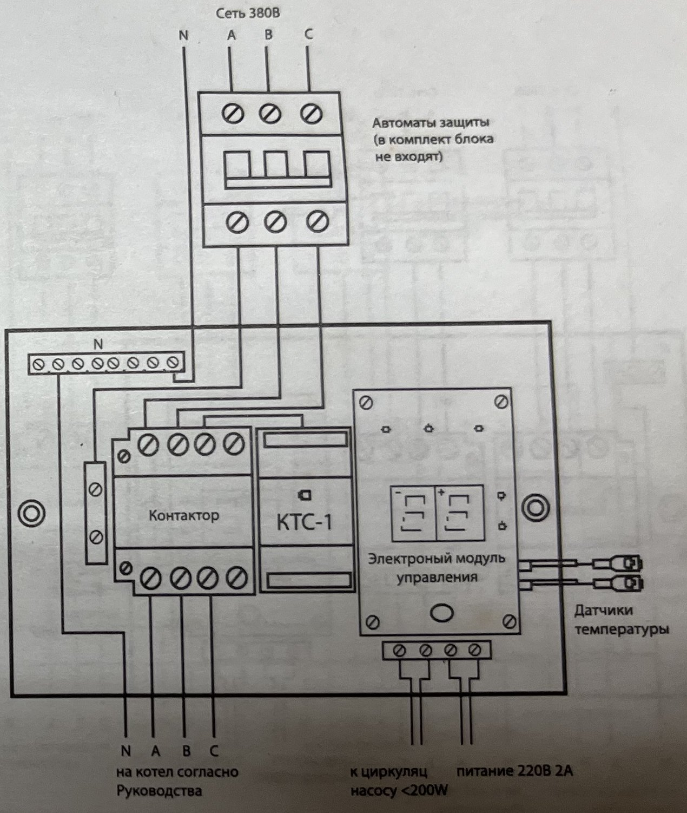
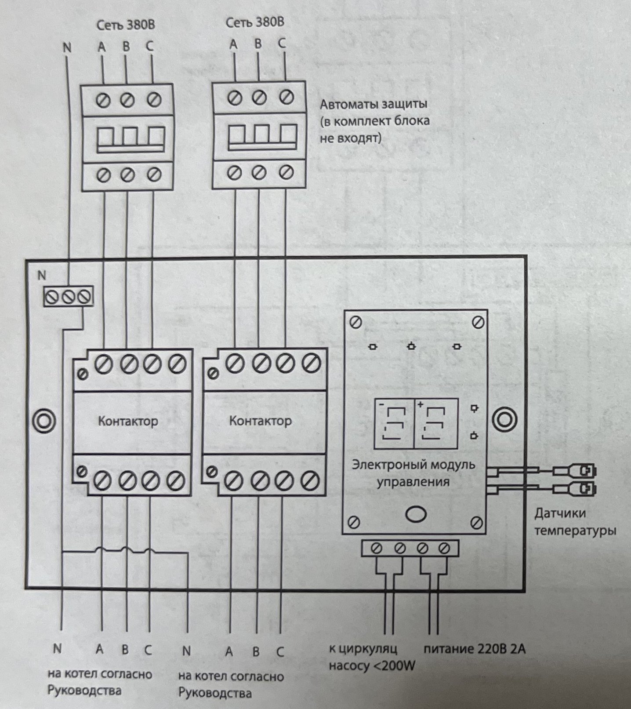
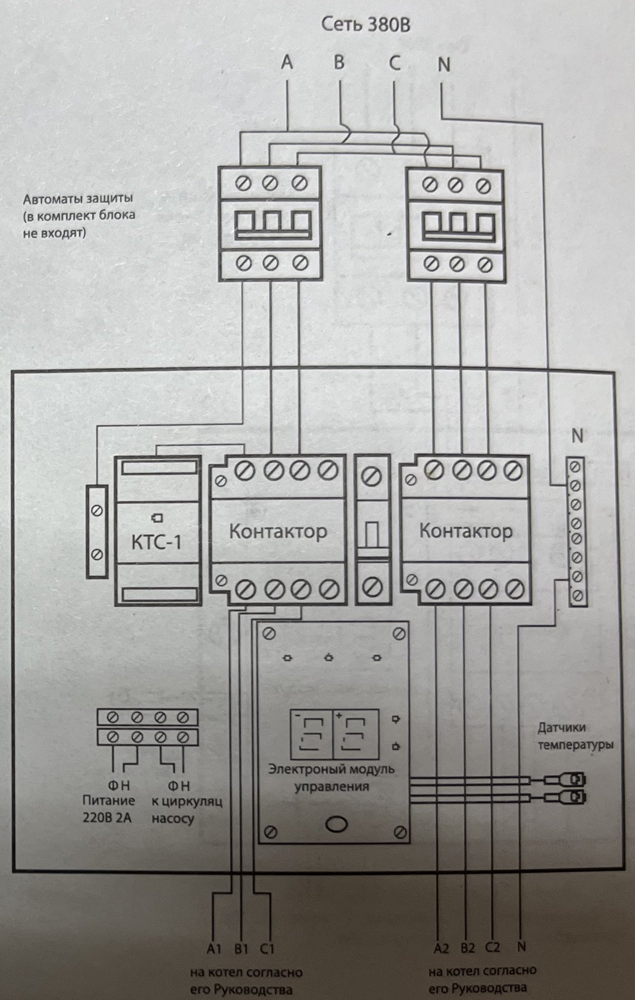
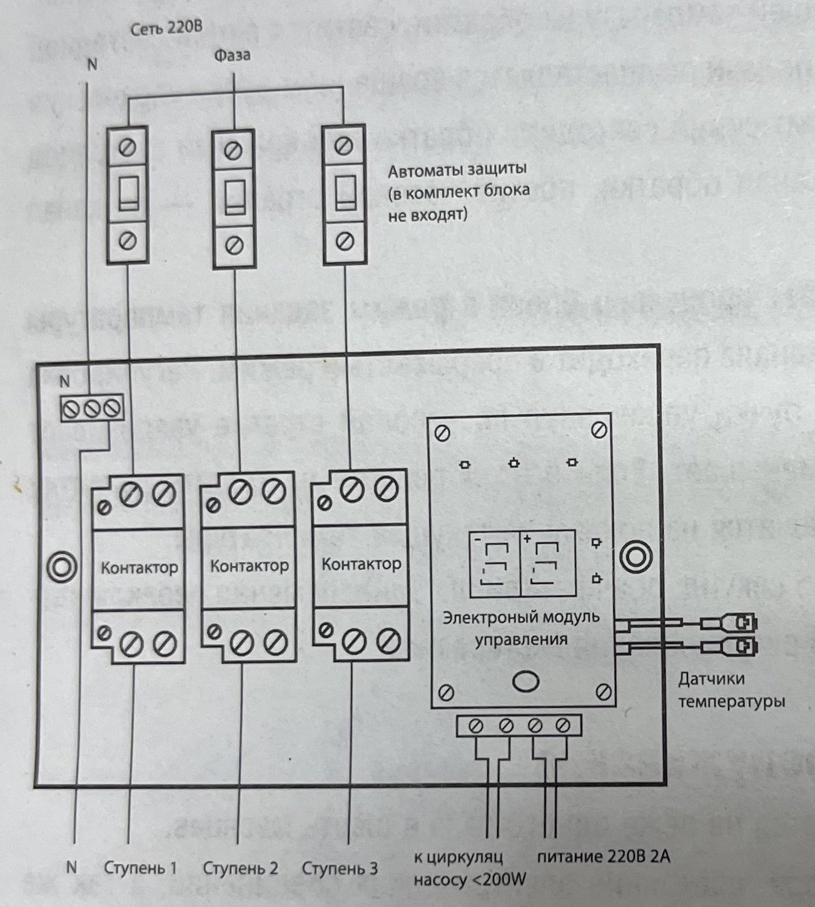
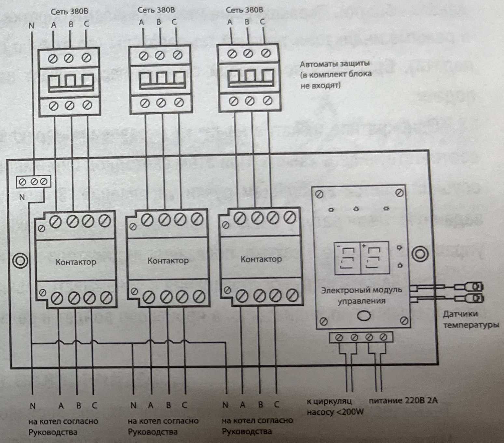

# "Navigator" temperature controller. Operating manual

<!-- page 1 -->

**GALAN ™ GALAN**
WARMWORLD · WORLD OF WARMTH

**MANUAL**
for use and operation

**Two-channel electronic temperature controller "NAVIGATOR"**

Version: ______ *(handwritten: "B" (Basic))*

RST conformity mark, ME 69

---

<!-- page 2 -->

# Contents

| Chapter | Page |
|---|:---:|
| Purpose | 3 |
| Description and operating principle | 4 |
| Scope of supply | 6 |
| Safety instructions | 6 |
| Installation, preparation for operation | 7 |
| Switching on, setting the operating modes of the Navigator | 12 |
| Maintenance | 12 |
| Storage rules | 13 |
| List of possible faults and methods of rectification | 14 |

---

<!-- page 3 -->

# 1. Purpose

1.1. The two-channel electronic temperature controller "Navigator" (hereinafter the temperature controller) is designed to maintain the set thermal operating mode of electric heaters (electrode-type electric water heaters, tubular heating element boilers, heat guns, air curtains, convectors, etc.) and to control the circulation pump of the heating system.

1.2. The main temperature control is performed over two channels: the supply (flow) pipe and the return pipe. In addition, room air temperature control is available via the "Istopnik" room controller or the "Galan GSM" cellular heating equipment monitoring system.

1.3. Using the temperature controller reduces electricity consumption and provides the most favorable temperature conditions in the heated room.

1.4. The manufacturer has the right to make changes to the design and electrical circuits of the temperature controller that do not worsen its metrological and technical characteristics.

---

<!-- page 4 -->

# 2. Description and operating principle

The "Navigator" digital temperature controller consists of a housing (Fig. 1), an electronic unit (3) with connected temperature sensors (red for the supply pipe and blue for the return pipe); heating stage operation indicators (2); circulation pump on indicator (4); external room temperature controller on indicator (5); return (blue) and supply (red) channel indicators (6); temperature display (7); control knob (8); switch (9); transition terminal block (10) for connecting the circulation pump and supplying 220 V power to the control unit; relay-contactor (11) (in the N2 version two contactors, in the N3 version three contactors); current controller (12) (for the NKT version); neutral busbar (13).

*Fig. 1. Controls and indicators of the "Navigator" temperature controller*

The labels on Fig. 1 are in Russian. Legend for the numbered elements:
- 1: housing (the text refers to it without a number)
- 2: heating stage operation indicators (LEDs)
- 3: electronic unit with connected temperature sensors
- 4: circulation pump on indicator (LED)
- 5: external room temperature controller on indicator (LED)
- 6: return (blue) and supply (red) channel indicators (LEDs)
- 7: temperature display
- 8: control knob
- 9: switch
- 10: transition terminal block (circulation pump connection, 220 V power supply to the control unit)
- 11: relay-contactor (N2 version: two contactors, N3 version: three contactors)
- 12: current controller (KT version)
- 13: neutral busbar

Temperature is controlled over two channels, from the supply pipe sensor (red) and the return pipe sensor (blue). The return sensor is the main control sensor. The supply sensor serves as an emergency sensor to prevent boiling and as a backup if the return sensor fails.

---

<!-- page 5 -->

| **Setting range:** | **Recommended values:** |
|---|---|
| Return: 10-80°C. | Return: 35-40°C. |
| Supply: 10-85°C. | Supply: 70-75°C. |
| Hysteresis: 1-9°C | Hysteresis: 3-5°C |

In this manual, hysteresis is the temperature difference between the boiler switching off and the subsequent switching back on.

When the unit is switched on, the display 7 shows the current return temperature and the blue LED 6 lights up. A lit dot in the upper left corner of the display means a signal to switch on the circulation pump. To reduce the peak load on the mains, the heating stages switch on one after another. 30 seconds after the pump starts, the first heating stage is connected, 10 seconds after the first stage the second one, and then, another 10 seconds later, the third heating stage. As the heating system warms up, the heating stages switch off one by one to improve efficiency. When the temperature reaches the set value minus the hysteresis, the third stage switches off; when it reaches the set value minus half the hysteresis, the second stage switches off. When the set temperature is reached, heating switches off completely. To cool the boiler, the circulation pump keeps running for another 30 seconds after heating switches off, then stops. While the system is cooling, to even out the temperature field, the circulation pump switches on for 30 seconds every 5 minutes. When the system is cooling, the heating stages also switch on one after another.

When the maximum set supply temperature is reached, heating switches off completely until the temperature drops by 9°C. The temperature sensors are mounted on the metal parts of the heating system at a distance of 30-50 cm from the boiler.

---

<!-- page 6 -->

The temperature controller has two sockets for connecting external room air temperature control devices. When these devices are connected and the set air temperature is reached, heating switches off completely and a signal dot lights up in the upper middle part of the display.

The KT series of temperature controllers is designed for electrode boilers and includes a current controller, which switches heating off for 3 minutes when the rated current value is exceeded, after which the heating cycle repeats. When the current controller trips, the LED changes color from green to red.

The maximum permissible electrical power on the "pump" output is 200 W. If a circulation pump of higher power is needed, connect it through switching equipment.

# 3. Scope of supply

1. Multi-channel electronic control and display unit of the "Navigator" temperature controller, 1 pc.
2. Digital integrated temperature sensors (2 pcs)
3. Operating manual, 1 pc.
4. Packaging, 1 pc.

# 4. Safety instructions

4.1. By the method of protection against electric shock, the temperature controller complies with class 0 per GOST 12.2.007.075.

4.2. The temperature controller uses voltage that is dangerous to life. When troubleshooting, performing maintenance or installation work, the temperature controller and the devices connected to it must be disconnected from the mains.

---

<!-- page 7 -->

4.3. The temperature controller is designed for use in non-hazardous (non-explosive) rooms.

4.4. Moisture must not get onto the output contacts of the terminal blocks or the internal electronic components of the temperature controller. The temperature controller must not be used in aggressive environments where the atmosphere contains acids, alkalis, oils, etc.

4.5. The temperature controller may be operated in a room where the temperature is not below +5°C and not above +40°C and the relative humidity does not exceed 85%.

4.6. Installation and maintenance of the temperature controller must be carried out by qualified specialists who have studied this operating manual.

4.7. During operation and maintenance, the requirements of the "Rules for the Technical Operation of Electrical Installations and Consumers" and the "Safety Rules for the Operation of Electrical Installations of Consumers" must be observed.

# 5. Installation, preparation for operation

5.1. Fasten the unit vertically to a wall in a dry, ventilated room using self-tapping screws.

Remove the control knob 8 (Fig. 1), unscrew the two screws and remove the cover of the Navigator unit, and route the supply cables according to the wiring diagrams.

5.2. Route the connecting wires from the temperature sensors, the 220 V module power supply, the circulation pump control and the external device control. The temperature sensors are mounted on metal sections of the pipework at a distance of 30-50 cm from the boiler.

5.3. When installing external connections, ensure reliable contact with the terminals of the temperature controller.

Use copper wire with a conductor cross-section of 0.5-2.5 mm² for the control cables.

---

<!-- page 8 -->

Strip the end of the cable for connecting the control circuits to a length of 7±0.5 mm. A longer end may cause a short circuit, and a shorter end may cause an unreliable connection. Open the terminal screw and insert the stripped end of the cable into the terminal.

Tighten the terminal to the recommended torque for control circuits: 0.5 N·m.

Under-tightening may lead to a loose connection and incorrect operation, while over-tightening may cause a short circuit or damage the terminal block.

**Attention!**

When using stranded wire, twist the strands at the stripped end of the cable, or use a crimped cable ferrule before fastening. Do not tin the end of the wire, to avoid poor contact.

5.4. The mains supply of the control module and the power elements of the unit is connected according to the diagrams shown in Figs. 2-7. The cross-section of the power cables and the rating of the switching devices are selected according to the boiler power. Installing circuit breakers upstream of the Navigator unit is mandatory.

5.5. Attention! Power is applied only after checking that all devices are connected correctly and that all threaded electrical connections are tightened. After power is applied, the digital display shows information characterizing the mode in which the temperature controller is operating.

---

<!-- page 9 -->

*Fig. 2. Wiring diagram of the "Navigator Basic" units.*

The labels on Fig. 2 are in Russian. Their meaning: 380 V mains; N; A; B; C; circuit breakers (not included with the unit); contactor; electronic control module; temperature sensors; to the boiler per the manual; to circulation pump <200 W; 220 V 2 A power.

*Fig. 3. Wiring diagram of the "Navigator Basic KT" units.*

The labels on Fig. 3 are in Russian. Their meaning: 380 V mains; N; A; B; C; circuit breakers (not included with the unit); contactor; KTS-1; electronic control module; temperature sensors; to the boiler per the manual; to circulation pump <200 W; 220 V 2 A power.

---

<!-- page 10 -->

*Fig. 4. Wiring diagram of the "Navigator Basic +" units.*

**Legend for Fig. 4:** The labels on the drawing are in Russian.
- 380 V mains
- N, A, B, C: neutral and phase conductors
- circuit breakers (not included with the unit)
- contactor
- electronic control module
- temperature sensors
- to the boiler per its manual
- to circulation pump <200 W
- 220 V 2 A power

*Fig. 5. Wiring diagram of the "Navigator Basic KT +" units.*

**Legend for Fig. 5:** The labels on the drawing are in Russian.
- 380 V mains
- circuit breakers (not included with the unit)
- KTS-1 module (original marking: KTS-1)
- contactor
- electronic control module
- temperature sensors
- "FN" 220 V 2 A power (the manual does not explain the "FN" marking, the original marking is kept)
- "FN" to circulation pump
- to the boiler per its manual
- A1, B1, C1, A2, B2, C2, N: output and input phases, neutral

---

<!-- page 11 -->

*Fig. 6. Wiring diagram of the "Navigator T" unit.*

**Legend for Fig. 6:** The labels on the drawing are in Russian.
- Mains 220 V
- Phase
- circuit breakers (not included with the unit)
- Stage 1, Stage 2, Stage 3
- contactor
- electronic control module
- temperature sensors
- to circulation pump <200 W
- 220 V 2 A power
- N: neutral

*Fig. 7. Wiring diagram of the "Navigator TT" units.*

**Legend for Fig. 7:** The labels on the drawing are in Russian.
- 380 V mains
- circuit breakers (not included with the unit)
- contactor
- electronic control module
- temperature sensors
- to the boiler per the manual
- to circulation pump <200 W
- 220 V 2 A power
- N, A, B, C: neutral and phase conductors

---

<!-- page 12 -->

## 6. Switching on and setting the operating modes of the Navigator

The control panel contains a rocker switch, an indicator and a round control knob. When the unit is switched on, the display shows the current return temperature and the blue return channel LED lights up. Switching between the return and supply channels is done by turning the control knob in the current temperature display mode (the blue return LED or the red supply LED stays steadily lit). Turning clockwise switches to the return channel, turning counterclockwise switches to the supply channel.

A single press of the control knob switches the unit's processor to the temperature setting mode of the corresponding channel. The channel LED then switches to blinking mode. Adjustment is made by turning the control knob. Turning clockwise increases the set temperature of the channel, counterclockwise decreases it. If the control knob is not touched for more than 5 seconds in this mode, the display switches back to showing the current temperature.

If the control knob is pressed and held for more than 5 seconds, both LEDs switch to blinking at the same time, and the processor enters the hysteresis adjustment mode.

## 7. Maintenance

The temperature controller must be serviced at least once every six months.

Check the mounting of the temperature controller and the condition of the electrical connections, and remove dust from the terminal blocks.

---

<!-- page 13 -->

## 8. Storage rules

Temperature controllers in the manufacturer's packaging must be stored in warehouses at temperatures from -50°C to +40°C and relative air humidity up to 85%.

The storage room must be free of dust, acid and alkali vapors, and gases that cause corrosion. During storage, the temperature controller is removed from the shipping packaging.

---

<!-- page 14 -->

## 10. List of possible faults and methods of rectification

| Fault | Probable cause | Method of rectification |
|---|---|---|
| No indication of unit operation | 1. No mains supply voltage | 1. Check that mains voltage is present |
| No indication of unit operation | 2. Incorrect mains connection | 2. Connect the controller according to the wiring diagram in this manual. |
| No indication of unit operation | 3. Board mains fuse blown | 3. Replace the fuse |
| "Er" message appears on the display | 1. Poor contact at the sensor connections | 1. Check the contact on the terminal blocks |
| "Er" message appears on the display | 2. Broken sensor wire | 2. Restore the wiring continuity |
| "Er" message appears on the display | 3. Sensor failure | 3. Replace the sensor |
| No indication that heating stages are switching on | 1. Incorrectly set target temperature | 1. Set the target temperature above the actual temperature |
| No indication that heating stages are switching on | 2. External room temperature sensor has tripped | 2. Check for the "external control" signal on the display and on the external room temperature sensor |

<!-- Note: in the printed table, the cells of the first column are merged across rows; the value is repeated in each row. -->
